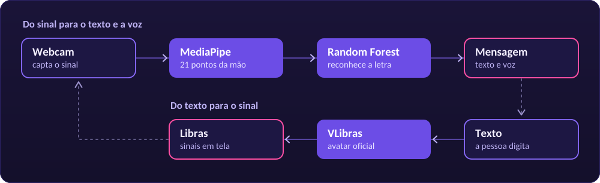
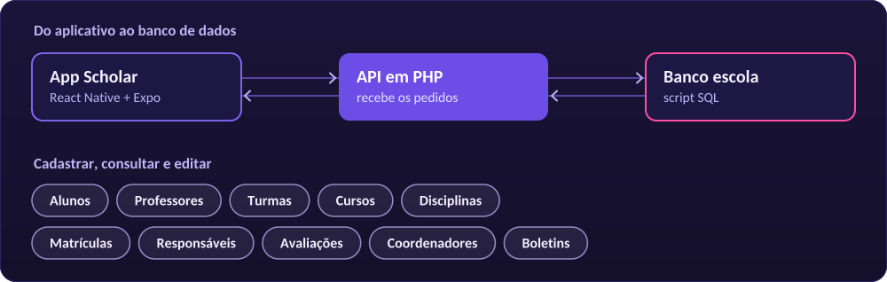
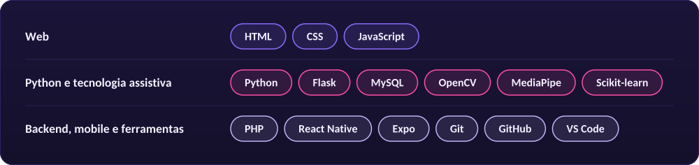

   
LinkedIn Repositórios LIBRATOR App Scholar

  
Sobre mim
Sou estudante de Desenvolvimento de Sistemas e estou construindo minha trajetória em tecnologia por meio de projetos práticos. Me interesso por desenvolvimento web e mobile, programação com Python, bancos de dados e por soluções que tornem tarefas e experiências mais acessíveis.

<table> <tr> <td width="190"><b>Como aprendo</b></td> <td>Colocando a mão no código, experimentando e melhorando a cada versão.</td> </tr> <tr> <td><b>O que me move</b></td> <td>Tecnologia assistiva e acessibilidade digital.</td> </tr> <tr> <td><b>Onde quero evoluir</b></td> <td>Lógica, organização de código, experiência do usuário e fundamentos de Engenharia de Software.</td> </tr> <tr> <td><b>Meu objetivo</b></td> <td>Construir uma base sólida e desenvolver aplicações que resolvam problemas reais.</td> </tr> </table>
Não estou aqui para fingir que já sei tudo. Estou aqui para aprender com consistência, mostrar o que construo e continuar melhorando.

 
Projetos em destaque
LIBRATOR: tecnologia assistiva para Libras

Sistema de tradução bidirecional para Libras, criado para facilitar a comunicação entre pessoas surdas e ouvintes em ambientes educacionais. A interface acessível reúne composição de mensagens e síntese de voz, e a tradução funciona nos dois sentidos:

Do sinal para o texto e a voz. A webcam capta a mão, o MediaPipe encontra 21 pontos de referência e um modelo Random Forest reconhece a letra do alfabeto manual de Libras. As letras formam a mensagem, que também pode ser falada.
Do texto para o sinal. A pessoa digita e o avatar oficial do VLibras apresenta o texto em Libras.
<table> <tr> <td width="190"><b>O que explora</b></td> <td>Reconhecimento de sinais, processamento de imagem, aprendizado de máquina e acessibilidade.</td> </tr> <tr> <td><b>Tecnologias</b></td> <td>Python, Flask, OpenCV, MediaPipe, Scikit-learn, HTML, CSS e JavaScript.</td> </tr> <tr> <td><b>No repositório</b></td> <td>Organizado em <code>libras-recognizer</code>, <code>librator</code>, <code>MVP</code> e <code>Docs</code>.</td> </tr> </table>  
Explorar o LIBRATOR no GitHub

 
App Scholar: gestão escolar no celular

Aplicativo mobile de gestão escolar, feito com React Native e Expo no Expo Snack. Ele permite cadastrar, consultar e editar os dados de uma escola, com uma tela inicial, uma tela Sobre e módulos de gerenciamento ligados por navegação entre telas. Os dados vêm de uma API em PHP conectada ao banco escola, então para ver as informações no app é preciso importar o banco e rodar a API.

<table> <tr> <td width="190"><b>O que explora</b></td> <td>Desenvolvimento mobile, navegação entre telas, consumo de API e integração com banco de dados.</td> </tr> <tr> <td><b>Tecnologias</b></td> <td>React Native, Expo, JavaScript, PHP e SQL.</td> </tr> </table>  
Ver o código do App Scholar

<!-- Quando tiver o link do Snack, apague a primeira e a última linha deste bloco (os marcadores de comentário) e troque COLE-AQUI-O-LINK-DO-SNACK pelo endereço:  -->  
Outros projetos
Projetos web em que pratiquei estrutura, estilo e organização de páginas.

Projeto	O que praticei	Links
🦇 Batman Fan Arkham	Site de fã sobre a saga Batman: Arkham, com seções de jogos, personagens, vilões e easter eggs.	Demo · Código
🗡️ Assassin's Creed	Projeto temático inspirado na franquia, para praticar estruturação de páginas, estilização e construção de uma experiência visual.	Demo · Código
⚽ Tabela do Brasileirão	Interface web com tema de futebol, feita para praticar a organização e a apresentação de informações na página.	Demo · Código
📝 Cadastro ETEC	Formulário para praticar estrutura HTML, organização de campos e criação de interfaces de cadastro.	Demo · Código
Ver todos os repositórios

 
Tecnologias
São as tecnologias que já usei em estudos ou projetos. A lista mostra a minha prática atual e os assuntos que sigo aprofundando, não um domínio avançado de tudo.

  
GitHub em números

   
 
  

  

Feito com curiosidade, código e 💜 por Wenderson Sousa Leal

